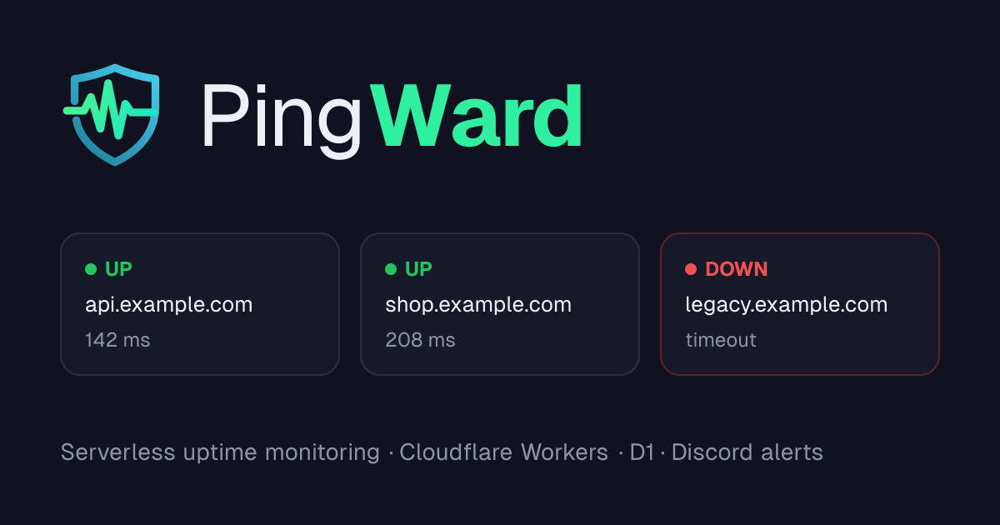
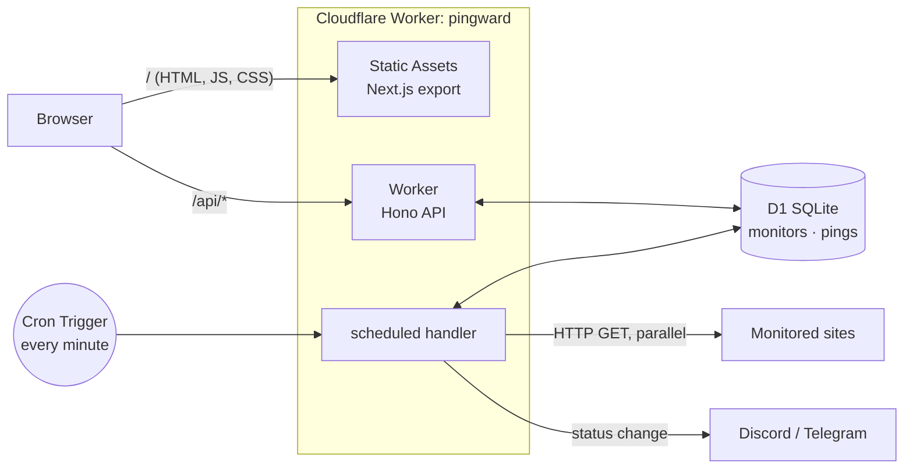

<p align="center"></p>

**A serverless uptime monitor built entirely on the Cloudflare edge.**
PingWard checks your websites and APIs on a schedule, records response times, draws latency charts, and alerts you on Discord or Telegram the moment something goes down (or comes back up). No servers to manage and no monthly bill: it runs on Cloudflare's free tier, and **one Worker serves both the dashboard and the API**. Prefer your own hardware? The same app ships as a Docker image.

[](https://github.com/vxlhr/pingward/actions/workflows/ci.yml)


**Live demo:** [pingward.pingward-worker.workers.dev](https://pingward.pingward-worker.workers.dev) (read-only for visitors)

[](https://deploy.workers.cloudflare.com/?url=https://github.com/vxlhr/pingward)



## Quick start

1. **Deploy.** Either click **Deploy to Cloudflare** above and set an `API_TOKEN` (16+ characters; a UUID works), or run it yourself with Docker:

   ```bash
   docker run -d -p 8787:8787 -e API_TOKEN=<16+ characters> -v pingward-data:/data ghcr.io/vxlhr/pingward
   ```

2. **Sign in.** Open your PingWard URL, click **Sign in** and paste the token.
3. **Monitor.** Click **Add monitor**, enter your site's URL, and optionally a Discord webhook or Telegram chat for alerts.

Details for every option are under [Deploy to your own Cloudflare account](#deploy-to-your-own-cloudflare-account-free).

---

## Features

- **Zero cold starts at the edge.** The API and the checker run on V8 isolates, which start in milliseconds and run close to your users.
- **One Worker, one deploy, one origin.** The Next.js dashboard is shipped as Workers Static Assets next to the API. There's no separate frontend host, and no CORS in production.
- **Global Cron Triggers.** A cron fires every minute. Each monitor has its own interval (1–1440 min), and the Worker decides which ones are due.
- **Parallel checks.** Due monitors are fetched concurrently with `Promise.allSettled`, each with a 10 s timeout. Results are written in a single atomic D1 `batch()`.
- **No alerts for a single blip.** A failed check is re-run a minute later, and a monitor only turns DOWN (incident and alert) after 2 failures in a row. One success brings it back UP.
- **Content checks.** Optionally accept other status codes (e.g. `200-299, 401`) and require a keyword on the page, so a "200 OK" error page still counts as down.
- **Maintenance windows.** Pause checks and alerts for 1, 4, or 24 hours from the dashboard. Planned downtime doesn't count against uptime, and the monitor resumes on its own.
- **Public status page.** `/status` shows every public monitor with 90 daily uptime bars and recent incidents, like the status pages of big services.
- **Discord and Telegram alerts.** When a monitor goes UP → DOWN or DOWN → UP, PingWard posts to that monitor's Discord webhook and/or Telegram chat (status code, latency, error). A **Send test alert** button checks every channel before a real outage does. A **Find my chat** helper picks your Telegram chat ID for you.
- **Public or private, per monitor.** Private monitors are checked and alert as usual, but only appear after you sign in. Your own sites stay off the public demo, which can show well-known services instead.
- **Incident history.** Every outage is recorded with its start, end, duration, and first error. Cards show how long a site has been down.
- **Latency dashboard.** Live status cards, uptime, a Recharts response-time chart (recent checks, or hourly averages over 24 h / 7 d / 30 d), and a status history strip. Monitors can be added, edited, paused, and deleted from the dashboard.
- **Secure by default.** Writes fail closed: without an `API_TOKEN` secret, production refuses them. Reads are public, or private with `READ_PROTECTED`. There's per-IP rate limiting, and private/internal targets are blocked (SSRF guard). Webhook URLs never leave the server. A strict CSP and security headers ship on every page. See [Security model](#security-model).
- **Self-cleaning.** Ping history older than 7 days is pruned hourly, so D1 stays small.
- **Free-tier aware.** An explicit capacity model keeps subrequests and D1 reads and writes under Cloudflare's free limits. Capacity is adjustable from the dashboard's Settings window, with no redeploy.
- **Safe schema changes.** The schema is managed with versioned D1 migrations, so re-running setup never drops data.
- **Tested.** Vitest unit tests cover scheduling, timeouts, alert payloads, SSRF validation, auth modes, rate limiting, and CORS. CI runs on every push.

## Architecture



| Layer | Tech | Why |
| --- | --- | --- |
| API | [Hono](https://hono.dev) on Cloudflare Workers | Tiny, typed, Web-standard router built for edge runtimes |
| Scheduler | Workers Cron Triggers (`scheduled` handler) | Serverless cron, no always-on process |
| Database | Cloudflare D1 (SQLite) | Relational, SQL, free tier, bound directly to the Worker |
| Frontend | Next.js (App Router) + Tailwind CSS + Recharts | Static export (`output: 'export'`), served as Workers Static Assets |
| Tooling | TypeScript, Vitest, ESLint, GitHub Actions, npm workspaces | Monorepo with one lockfile and one command to check everything |

**Routing:** `run_worker_first = ["/api/*"]` sends API calls to the Worker code. Every other path is answered directly from Cloudflare's asset cache, which doesn't count against Worker invocations.

### How a check works

1. Cron fires → `scheduled()` loads the settings and every monitor that isn't `PAUSED`, in one D1 batch.
2. `selectDueMonitors()` keeps those whose `last_checked_at + interval` has passed, up to the configured **check capacity** (see [Capacity model](#capacity-model)). Monitors in a maintenance window are skipped. A monitor whose last check failed is due again after one minute and goes first.
3. Each URL is fetched in parallel. Redirects are followed by hand (at most 3) and every hop is re-validated. The final response is **OK** when its status is accepted (any `2xx` by default) and, if the monitor has a keyword, the first 64 KB of the body contain it. Anything else, a network error, or a timeout is a **failure**.
4. A failure only turns the monitor **DOWN** once it has failed twice in a row; the first one just raises its `fail_streak`. A success sets it **UP**.
5. One D1 batch inserts the ping, updates the monitor (status, fail streak, last check, latency), and bumps an hourly counter (checks, successes, total response time).
6. Monitors whose status changed get a Discord embed and/or a Telegram message. Outages go first, and every alert is paid for from the run's subrequest budget. Monitors paused or deleted while their check was running are skipped.

### Capacity model

Cloudflare's free plan has hard limits: **50 subrequests** per cron run (fetches, every redirect hop, D1 queries, and Discord calls all count), and D1 allows **100k rows written** and **5M rows read** per day. Without a budget, a busy instance would hit them and D1 would refuse every query until midnight UTC.

PingWard budgets for this explicitly:

- **Check capacity** = checks per cron run (every minute). A monitor needs `1 / interval` of it, so capacity 7 covers 7 sites every minute, 35 every 5 minutes, or any mix. Adding or resuming a monitor that doesn't fit is refused with a hint (e.g. "use an interval of 3 minutes or more").
- **Subrequests, worst case per run on the free plan:** 7 checks × 4 hops (1 + 3 redirects) + 4 D1 calls (read, write, hourly prune) + 7 Discord + 7 Telegram alerts = **46** (limit 50). That's every site redirecting three times and every monitor going down at once with both channels, and a test runs exactly that scenario.
- **Second lock:** each run also counts its subrequests as it goes (`SubrequestBudget`) and never starts one that wouldn't fit. If a future change ever broke the math above, alerts would be skipped and logged rather than the run failing.
- **D1 writes:** about 6 rows per check (ping and its index, monitor row, hourly counter, later pruning). Full capacity is about **60k rows/day** (limit 100k). Alerts and incidents only write on status changes. Confirming a failure is just another check, so it also comes out of the check capacity. Daily counters for the status page are rolled up from the hourly ones once an hour (≈ 1 row per monitor per hour), so checks themselves write nothing extra.
- The dashboard reads uptime from **hourly counters** (≤ 25 rows per monitor) instead of every ping, polls once a minute, and only while the tab is visible. The status page reads ≤ 90 daily rows plus today's hourly rows per public monitor, and browsers cache it for a minute.

Capacity, plan, and ping retention are edited in the dashboard's **Settings** window and stored in D1, so changing them doesn't need a redeploy. Each plan has a hard ceiling in code (`PLAN_LIMITS`): free = 7 checks/min and 50 monitors; paid ($5/month Workers plan) = 100 checks/min and 500 monitors. The Settings window shows the worst-case subrequest count live as you change the capacity. A setting can't be lowered below what the active monitors already need.

## Project structure

```
pingward/
├── shared/                 # API types + limits used by both Worker and dashboard
├── worker/                 # Cloudflare Worker (API + cron + static assets)
│   ├── src/
│   │   ├── index.ts        # Hono routes, auth / rate-limit middleware, fetch + scheduled export
│   │   ├── checker.ts      # scheduling, HTTP checks, D1 writes
│   │   ├── validation.ts   # URL / SSRF and webhook validation
│   │   ├── alerts.ts       # which alerts to send + per-run subrequest budget
│   │   ├── discord.ts      # Discord embed builder + sender
│   │   ├── telegram.ts     # Telegram messages, error hints, chat lookup
│   │   └── types.ts        # Env bindings
│   ├── migrations/         # versioned D1 schema (0001_init.sql, ...)
│   ├── test/               # Vitest unit tests
│   └── tsconfig.json
├── frontend/               # Next.js dashboard (static export → frontend/out)
│   ├── app/                # layout + page
│   ├── components/         # cards, dialogs, chart
│   ├── lib/api.ts          # typed API client
│   └── public/_headers     # security + cache headers for static assets
├── docker/start.sh         # container entrypoint (migrations, cron timer, Worker)
├── Dockerfile, docker-compose.yml
├── wrangler.toml           # Worker config: assets, D1, rate limiter, cron trigger, vars
├── .dev.vars.example       # secrets (API_TOKEN, TELEGRAM_BOT_TOKEN), also read by "Deploy to Cloudflare"
└── .github/workflows/      # ci.yml (tests, build, smoke test), docker.yml (image build, test, publish)
```

## API

| Method | Path | Auth | Description |
| --- | --- | --- | --- |
| `GET` | `/api/health` | – | Health check plus protection mode (`writeProtected`, `readProtected`) |
| `GET` | `/api/monitors` | – ¹ ² | All monitors with status, last latency, 24 h uptime |
| `GET` | `/api/monitors/:id` | – ¹ ² | Single monitor |
| `GET` | `/api/monitors/:id/pings?limit=50` | – ¹ ² | Recent pings, oldest → newest (max 500) |
| `GET` | `/api/monitors/:id/stats?range=24h` | – ¹ ² | Hourly checks, successes and average response time; `range` is `24h`, `7d` or `30d` |
| `GET` | `/api/status` | – ¹ | Status page data: public monitors with 90 daily uptime bars, and their incidents from the last 14 days |
| `POST` | `/api/monitors` | Bearer | Create `{ url, name, interval_minutes, discord_webhook?, telegram_chat_id?, is_public?, accepted_status?, keyword? }`. Returns 409 if it doesn't fit the check capacity or the plan's monitor cap |
| `PATCH` | `/api/monitors/:id` | Bearer | Edit `{ name?, url?, interval_minutes?, discord_webhook?, telegram_chat_id?, is_public?, accepted_status?, keyword? }` (`null` removes an alert channel or a check rule), pause/resume `{ paused: boolean }`, or start/end maintenance `{ maintenance_minutes: 0–10080 }` (0 ends it). Returns 409 if a shorter interval or a resume doesn't fit the capacity |
| `POST` | `/api/monitors/:id/test-alert` | Bearer | Send a test message to every alert channel; returns one result per channel |
| `GET` | `/api/telegram` | Bearer | Bot status and the chats that recently messaged it (to pick a chat ID) |
| `GET` | `/api/monitors/:id/incidents?limit=20` | – ¹ ² | Outage history, newest first (max 100) |
| `DELETE` | `/api/monitors/:id` | Bearer | Delete a monitor and its pings |
| `GET` | `/api/settings` | Bearer | Plan, check capacity, ping retention, plan limits, and current usage |
| `PATCH` | `/api/settings` | Bearer | Change `{ plan?, checksPerMinute?, pingRetentionDays? }` (validated against plan limits and usage) |

¹ Bearer token required when `READ_PROTECTED=true`. ² Without the token, private monitors are left out of lists and return `404`. All `/api/*` routes are rate-limited to 100 requests per minute per IP, and over the limit they return `429` with `Retry-After`.

```bash
curl -X POST http://localhost:8787/api/monitors \
  -H "Content-Type: application/json" \
  -H "Authorization: Bearer $API_TOKEN" \
  -d '{"url":"https://example.com","name":"Example","interval_minutes":1}'
```

## Run locally

Requirements: Node.js 20+ and npm. You don't need a Cloudflare account for local development; Wrangler emulates Workers, D1, and static assets on your machine.

```bash
git clone https://github.com/vxlhr/pingward.git
cd pingward
npm install
npm run db:init        # apply D1 migrations to the local database
```

**Option A: production-like, one port.** Builds the dashboard and serves everything from the Worker at http://localhost:8787.

```bash
npm run preview
```

**Option B: with hot reload, two terminals.** The dashboard runs at http://localhost:3000 and calls the Worker at :8787 (`frontend/.env.development`).

```bash
npm run dev:worker     # terminal 1
npm run dev:frontend   # terminal 2
```

`wrangler dev` never fires Cron Triggers by itself. In another terminal, run this to get checks every minute like in production:

```bash
npm run cron:local
```

Or trigger a single run by hand: `curl "http://localhost:8787/__scheduled?cron=*+*+*+*+*"`.

Local dev allows writes without a token so you can try things quickly. To test the real behaviour, copy `.dev.vars.example` to `.dev.vars`, then sign in with the same token in the dashboard.

Run the full check suite (typecheck, tests, lint, build):

```bash
npm run check
```

## Deploy to your own Cloudflare account (free)

### One click

[](https://deploy.workers.cloudflare.com/?url=https://github.com/vxlhr/pingward)

1. Click the button and sign in to Cloudflare (a free account is enough, no card required).
2. Pick a name and choose your GitHub account. Cloudflare copies this repo there, creates the D1 database, and sets up automatic deploys.
3. Enter an **API_TOKEN**: at least 16 characters of letters, digits and `- _ . ~ + /` (a UUID works well). This is your admin password for the dashboard. Leave **TELEGRAM_BOT_TOKEN** empty unless you want Telegram alerts.
4. Click **Deploy**. The build creates the tables, publishes the dashboard, and starts the every-minute checks.

Open the URL Cloudflare shows, click **Sign in**, paste your token, and add your first monitor. Every push to your copy of the repo redeploys automatically.

### By hand

| You need | Notes |
| --- | --- |
| [Node.js](https://nodejs.org) 20 or newer | npm comes with it |
| [Git](https://git-scm.com) | to clone the repo |
| A [Cloudflare account](https://dash.cloudflare.com/sign-up) | the free plan is enough, no card required |

**1. Log in to Cloudflare.** A browser tab opens; click **Allow**.

```bash
npx wrangler login
```

**2. Create the database.**

```bash
npx wrangler d1 create pingward-db
```

> [!IMPORTANT]
> Copy the `database_id` this prints into `wrangler.toml`, replacing the one already there. The ID in the repo belongs to the demo deployment and won't work on your account.

**3. Set your admin token.** Without it, every write is refused.

```bash
npx wrangler secret put API_TOKEN
```

> [!WARNING]
> Use at least 16 characters of letters, digits and `- _ . ~ + /` only. Characters like `!`, `@`, `#` or spaces can't be sent as a Bearer token, so you could never sign in; short or example values like `change-me` are refused. A UUID works well: `node -e "console.log(crypto.randomUUID())"`.

**4. Deploy.** This builds the dashboard, creates or updates the tables, and uploads the Worker with its assets.

```bash
npm run deploy
```

Wrangler prints your URL (`https://pingward.<your-subdomain>.workers.dev`). Open it, click **Sign in**, paste your token, and add your first monitor. Visitors without the token see a read-only demo. Link previews pick up your URL automatically.

Each later `npm run deploy` rebuilds the dashboard and ships the Worker and its assets together.

### Self-host with Docker

Prefer your own server? The same Worker also runs in a container, on Cloudflare's open-source runtime (workerd) with a local SQLite database:

```bash
docker run -d --name pingward -p 8787:8787 \
  -e API_TOKEN=<16+ characters> \
  -v pingward-data:/data \
  ghcr.io/vxlhr/pingward:latest
```

Or with Compose: `API_TOKEN=<16+ characters> docker compose up -d`. Then open http://localhost:8787. Add `-e TELEGRAM_BOT_TOKEN=…` for Telegram alerts.

- Data lives in the `/data` volume; migrations run on start, and an internal timer fires the cron every minute.
- Checks run from your server instead of Cloudflare's edge, so the free-plan limits don't apply. Raise the capacity in **Settings** if you need more.
- The container runs Wrangler's local runtime, which is fine for personal and small-team use. For a public, high-traffic deployment, prefer the Cloudflare deploy above.

### Telegram alerts (optional)

1. In Telegram, open [@BotFather](https://t.me/BotFather), send `/newbot` and follow the prompts. It replies with a bot token like `123456789:AAE…`. Use a bot just for PingWard: **Find my chat** can't list chats for a bot that another app already drives with a webhook.
2. Store it as a Worker secret. No redeploy is needed.

   ```bash
   npx wrangler secret put TELEGRAM_BOT_TOKEN
   ```

3. Open your new bot in Telegram and press **Start**. For a group, add the bot to the group and send any message. For a channel, make the bot an admin.
4. In the dashboard, edit a monitor, click **Find my chat** next to *Telegram chat ID* and pick your chat. Then use **Send test alert** in the monitor's detail.

You can also type a chat ID by hand: a number such as `123456789` (users) or `-1001234567890` (groups and channels), or `@channelname` for a public channel. One bot serves every monitor; each monitor chooses its own chat.

To make the whole dashboard private, set `READ_PROTECTED = "true"` in `wrangler.toml` and deploy again.

Schema changes go in a new file such as `worker/migrations/0002_add_column.sql`; `npm run db:init:remote` applies only the new ones.

## Troubleshooting

| Symptom | Fix |
| --- | --- |
| PowerShell: `npm.ps1 cannot be loaded because running scripts is disabled` | Use `npm.cmd` and `npx.cmd` instead of `npm` and `npx` ([details](#windows-powershell-blocks-npm)) |
| Signing in fails, or the API answers `API_TOKEN contains unsupported characters` | Your token has a character such as `!`, `@` or a space. Set a new one ([details](#setting-the-token-without-the-interactive-prompt)) |
| `wrangler secret put` misbehaves: you can't delete what you typed, or a stray `*` shows up | Upload the token from a file instead ([details](#setting-the-token-without-the-interactive-prompt)) |
| Deploy or migrations fail with an error about the D1 database | `wrangler.toml` still has the demo's `database_id`. Replace it with yours (manual deploy step 2), or use the one-click button |
| The new `*.workers.dev` URL doesn't load right after the first deploy | A brand-new workers.dev subdomain needs a few minutes for DNS. Wait, then reload |
| Writes return `403 API_TOKEN is not configured` | Deploy step 4 was skipped. Set the token; no redeploy is needed |
| The API answers `API_TOKEN is too weak` | Set a longer token (16+ characters, not an example value like `change-me`) |
| Local dashboard says *Could not reach the API* | The Worker isn't running. Start `npm run preview` (or `npm run dev:worker`) |
| Locally, "Checked" never updates | `wrangler dev` doesn't fire crons. Run `npm run cron:local` in a second terminal |
| Adding a monitor returns `409 Not enough check capacity` | Use a longer interval, pause a monitor, or raise the capacity in **Settings** ([capacity model](#capacity-model)) |
| Telegram test alert: *Chat not found* | Open the bot and press **Start** (or add it to the group) first, then use **Find my chat** again |
| Telegram test alert: *The bot token is wrong* | Set `TELEGRAM_BOT_TOKEN` again with the token from @BotFather |
| *Find my chat* shows no chats | Telegram only lists recent messages. Send the bot a new message, then retry. It doesn't work if the bot has a webhook set elsewhere |
| `429 Too many requests` | More than 100 API calls per minute from your IP. Wait a minute |
| A site shows DOWN but opens fine in your browser | Open its detail. The incident's error tells you why: some sites block unknown bots (`HTTP 403`), redirect more than 3 times, or need longer than 10 s |

### Windows: PowerShell blocks npm

Windows PowerShell's default execution policy refuses npm's `.ps1` shim. Call the `.cmd` versions instead, which run the same commands:

```powershell
npm.cmd install
npx.cmd wrangler login
```

Alternatively, allow locally created scripts for your user only. This changes a security setting, so it's your call:

```powershell
Set-ExecutionPolicy -Scope CurrentUser RemoteSigned
```

### Setting the token without the interactive prompt

Some terminals send stray characters into `wrangler secret put`'s hidden prompt. A file avoids that:

1. Create `api-token.secrets.json`. The repo's `.gitignore` already excludes `*.secrets.json`.

   ```json
   { "API_TOKEN": "your-long-token-here" }
   ```

2. Upload it, then delete the file:

   ```bash
   npx wrangler secret bulk api-token.secrets.json
   ```

Setting the token again simply replaces the old one, and the Worker picks it up immediately without a redeploy.

## Security model

| Threat | Mitigation |
| --- | --- |
| Someone adds monitors to abuse your Worker | Writes need `API_TOKEN` (constant-time compare). Without the secret, production refuses writes (fail closed). |
| Server-side request forgery (SSRF) | Targets must be public http(s) hosts. `localhost`, `*.local`/`*.internal`, private/loopback/link-local/CGNAT IPv4 and IPv6 ranges, IPv4-mapped IPv6, and numeric tricks like `http://2130706433` are rejected. Cloudflare's network also blocks private ranges. |
| Leaking secrets | Discord webhook URLs and Telegram chat IDs are never returned by the API, and the Telegram bot token is a Worker secret. URLs with embedded credentials are rejected. The token lives only in the browser's `localStorage` and Worker secrets. |
| Quota exhaustion / scraping | 100 requests per minute per IP on `/api/*`, a check-capacity budget, a per-plan monitor cap, and ping retention. Static assets don't invoke the Worker at all. |
| XSS / clickjacking | Strict `Content-Security-Policy` (`connect-src 'self'`, `frame-ancestors 'none'`, `object-src 'none'`), `X-Frame-Options: DENY`, `nosniff`, HSTS. React escapes all rendered data. |
| Accidental data loss | Versioned D1 migrations, never `DROP TABLE` scripts. |

## Responsible use

PingWard sends an HTTP `GET` to each target as often as once a minute, with the user agent `PingWard/1.0 (+https://github.com/vxlhr/pingward)`. Monitor your own sites, or public services lightly: the live demo sends one `GET` every 5 minutes to the public front page or health endpoint of a few well-known services, which is less than one person browsing them. Respect each target's terms of service, and don't use PingWard to load-test or scrape sites you don't own. This software is provided "as is" under the MIT license, with no warranty.

## Free-tier notes

- See the [Capacity model](#capacity-model) for how the free Workers and D1 limits are budgeted.
- Static asset requests are free and unlimited, and they don't use up your Worker request quota.
- Raw pings are pruned after the configured retention (default 7 days), hourly counters after 30 days, and daily counters (status page) after 90 days.

## Roadmap

- [x] Edit monitors, test alerts, incident history
- [x] Telegram alerts with a chat-ID finder
- [x] Confirm failures before alerting (no alerts for a single blip)
- [x] Accepted status codes and keyword checks
- [x] Chart time ranges (24 h / 7 d / 30 d from the hourly counters)
- [x] Public status page with 90-day uptime bars
- [x] Maintenance windows
- [ ] JSON assertions
- [ ] SSL certificate expiry warnings
- [ ] Multi-user accounts (`user_id` is already in the schema)
- [ ] Slack and e-mail notifications

## License

[MIT](LICENSE)
